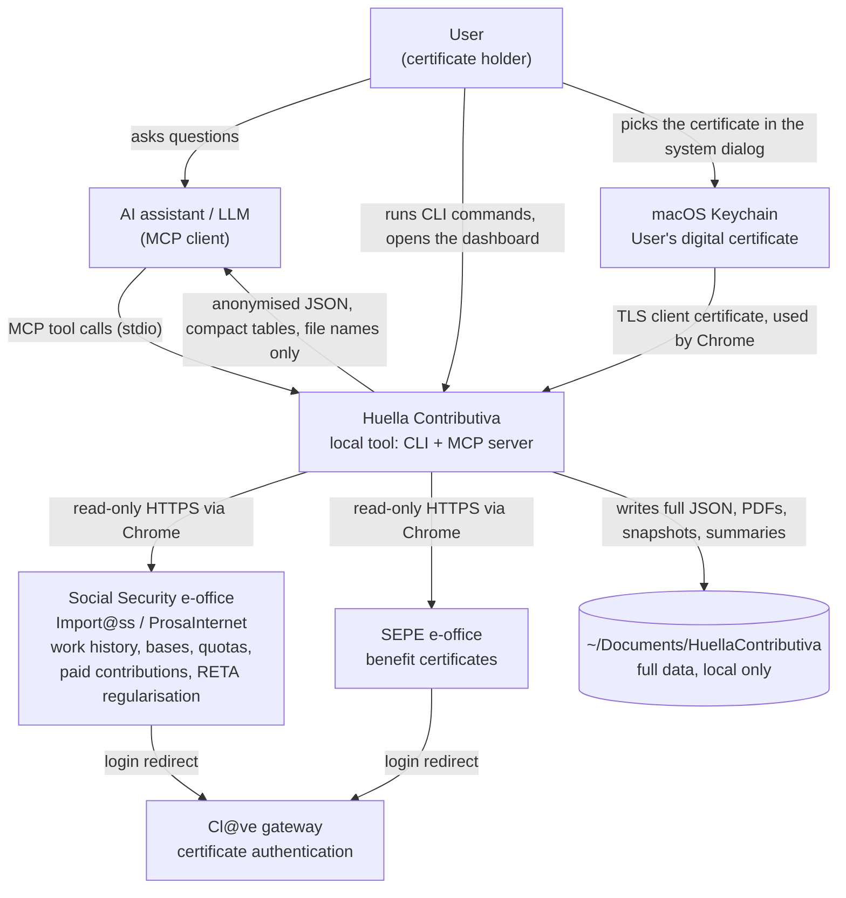
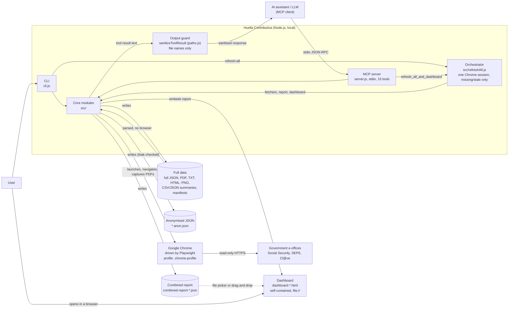
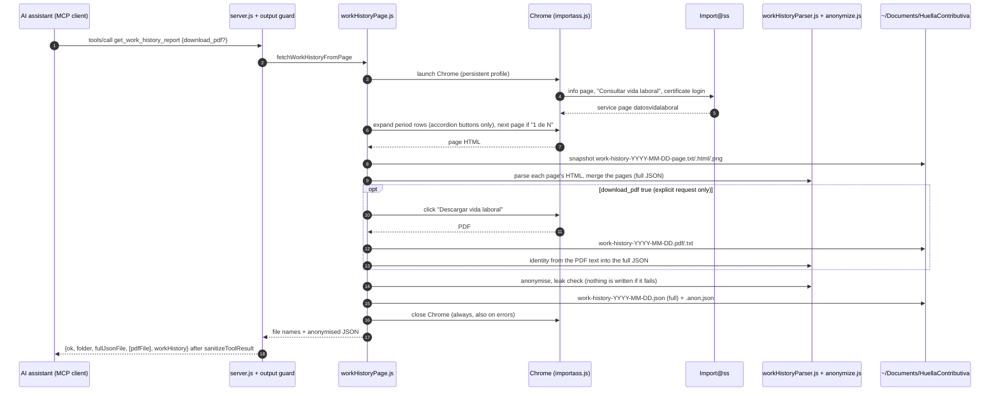
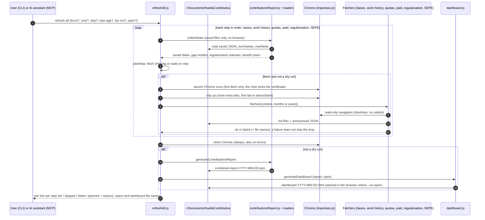

# Huella Contributiva — C4 models

Architecture of [Huella Contributiva](README.md) described with the [C4 model](https://c4model.com/): system context,
containers, components, and two dynamic views: one fetch and the one-command refresh. What reaches the LLM and what stays local is summarised in
the README section [What reaches the LLM and what stays local](README.md#what-reaches-the-llm-and-what-stays-local).

## Overview
The diagrams follow the [C4 model](https://c4model.com/) and are written as Mermaid flowcharts (GitHub renders them).
`<user>` stands for the macOS account name; it never appears in tool output.

## Level 1: System context
The User works with the tool through the CLI, or through an AI assistant acting as an MCP client. The tool runs only
on the User's Mac. It reaches the government e-offices through a local Google Chrome window over HTTPS, read-only.
Authentication uses the User's own certificate from the macOS Keychain, picked by the User in the system dialog. The AI
assistant (and the LLM behind it) receives only anonymised JSON, compact tables and file names.

## Level 2: Containers
Two entry points, the CLI and the stdio MCP server, share the core modules in `src/`. Every MCP response passes
through the server's output guard; the CLI prints through the same sanitiser. Browser steps run in the installed
Google Chrome driven by Playwright (`playwright-core`) with a persistent profile. Everything else (parsing, JSON
building, the combined report, the dashboard) works on the saved files without a browser.

All three groups live in `~/Documents/HuellaContributiva`; they are split above only to show what may reach the LLM: the
anonymised JSON content, compact summaries computed from the files, and file names. Raw page/PDF text and the full
JSON stay local.

## Level 3: Components
- Entry points: `cli.js` (commands, prints through `sanitizePaths`) and `server.js` (15 tools; its `registerTool`
  wrapper passes every result and thrown error through `sanitizeToolResult`).
- Browser layer: `importass.js` (Chrome launch, certificate login steps, guarded clicks with blocklists, PDF capture,
  report definitions, the bases PDF flow) — used by every live fetcher.
- Work history: `workHistoryPage.js` (page flow, JSON pair, `loadWorkHistory()`, `workHistoryView()`, tool payload) and
  `workHistoryParser.js` (pure: page HTML → full JSON, PDF identity, anonymised copy, benefit periods).
  `workHistory.js` re-exports `importass.js` and both modules.
- Contribution bases: `basesReport.js` (download wrapper, JSON pair, `loadContributionBases()`, `basesView()`, tool
  payload) and `basesParser.js` (pure: report text → sections, header identity, totals, compact anonymised copy,
  employee and self-employed months).
- Privacy helpers: `anonymize.js` (identity tokens, deep redaction, leak check) and `paths.js` (path sanitiser,
  `rawFiles`, `sanitizeToolResult`).
- Fetchers + pure parsers: `quotas.js` + `quotaParser.js`, `paidQuotas.js` + `paidParser.js`, `sepe.js` + `sepeParser.js`,
  `regularization.js` + `regularizationParser.js`.
- Orchestrator: `refreshAll.js` (`refresh-all` / `refresh_all_and_dashboard`): reads the saved state, plans each step
  (missing or stale only), runs the existing fetchers in one shared Chrome context, then the combined report and the
  dashboard. It re-plans each step just before running it, because earlier steps change the later plans.
- Report and dashboard: `contributionsReport.js` (merge, dedupe, gaps, notes, reconciliation, aggregates) and
  `dashboard.js` (concept enrichment, inlines `dashboard/template.html`, `style.css`, `model.cjs`, `app.js`).

Data dependencies:
- The FULL bases JSON (`loadContributionBases()`) gives the employee months for the quota calculations, the
  self-employed (RETA) months for the paid contributions report, the RETA years (from 2023) for the regularisation and
  the first year for SEPE `--all-years`; the combined report uses it for expected months and reference bases.
- The FULL work history JSON (`loadWorkHistory()`) gives the unemployment benefit periods (ERTE): the default SEPE
  years and the benefit months of the combined report. If only an older work history PDF text is saved, its text is
  parsed as a fallback.
- The regularisation reads the paid contributions summary as payment evidence.
- All saved results feed the combined report; the dashboard embeds that report and re-parses the quota snapshots
  for the concept lines.
- Every module that names a file in its output uses `paths.js` (`fileName`, `OUTPUT_DIR_LABEL`); the fetchers with a
  `detail="full"` mode also use `rawFilesFor` / `rawFilesBlock`. Only the `rawFiles` edges are drawn below.

```mermaid
flowchart TB
  subgraph entry["Entry points"]
    cli["cli.js<br/>prints via sanitizePaths"]
    mcp["server.js<br/>15 tools"]
    guard["registerTool wrapper<br/>sanitizeToolResult"]
  end

  subgraph browser["Browser layer"]
    importass["importass.js<br/>Chrome launch, certificate login,<br/>guarded clicks, PDF capture,<br/>bases PDF flow"]
  end

  subgraph wh["Work history"]
    whpage["workHistoryPage.js<br/>page flow, JSON pair,<br/>loadWorkHistory, tool payload"]
    whparser["workHistoryParser.js<br/>page HTML → full JSON,<br/>anonymised JSON, benefit periods"]
    whre["workHistory.js<br/>re-exports"]
  end

  subgraph basesg["Contribution bases"]
    basesrep["basesReport.js<br/>download wrapper, JSON pair,<br/>loadContributionBases, tool payload"]
    bases["basesParser.js<br/>text → sections, identity,<br/>totals, compact anon copy, months"]
  end

  subgraph privacy["Privacy helpers"]
    anon["anonymize.js<br/>identity tokens, redaction,<br/>leak check"]
    paths["paths.js<br/>path sanitiser, rawFiles"]
  end

  subgraph fetchers["Fetchers and parsers"]
    quotas["quotas.js + quotaParser.js<br/>quota calculations"]
    paid["paidQuotas.js + paidParser.js<br/>paid contributions (RETA)"]
    sepe["sepe.js + sepeParser.js<br/>SEPE certificates"]
    reg["regularization.js + regularizationParser.js<br/>RETA regularisation"]
  end

  subgraph orchg["Orchestrator"]
    orch["refreshAll.js<br/>plan (missing/stale), one Chrome context,<br/>step summary"]
  end

  subgraph outputs["Report and dashboard"]
    report["contributionsReport.js<br/>merge, gaps, notes, reconciliation"]
    dashjs["dashboard.js<br/>concept enrichment, inlining"]
    dashsrc["dashboard/<br/>template.html, style.css,<br/>model.cjs, app.js"]
  end

  mcp --> guard
  guard -->|"uses"| paths
  cli -->|"uses"| paths
  cli --> whpage
  cli --> basesrep
  cli --> quotas
  cli --> paid
  cli --> sepe
  cli --> reg
  cli --> report
  cli --> dashjs
  mcp --> whpage
  mcp --> basesrep
  mcp --> quotas
  mcp --> paid
  mcp --> sepe
  mcp --> reg
  mcp --> report
  mcp --> dashjs
  cli -->|"refresh-all"| orch
  mcp -->|"refresh_all_and_dashboard"| orch
  orch -->|"launchChrome (once)"| importass
  orch -->|"shared context"| basesrep
  orch -->|"shared context"| whpage
  orch -->|"shared context, months"| quotas
  orch -->|"shared context, months"| paid
  orch -->|"shared context, years"| reg
  orch -->|"shared context, years"| sepe
  orch -->|"loadSaved, buildFromSaved: gaps"| report
  orch -->|"generateDashboard"| dashjs
  whre -.-> importass
  whre -.-> whpage
  whre -.-> whparser

  whpage --> importass
  basesrep --> importass
  quotas --> importass
  paid --> importass
  sepe --> importass
  reg --> importass

  whpage -->|"page HTML"| whparser
  basesrep -->|"report text"| bases
  whparser -->|"redaction, leak check"| anon
  bases -->|"redaction, leak check"| anon
  quotas -->|"rawFiles, file names"| paths
  paid -->|"rawFiles, file names"| paths
  sepe -->|"rawFiles, file names"| paths
  reg -->|"rawFiles, file names"| paths

  basesrep -->|"full JSON: employee months"| quotas
  basesrep -->|"full JSON: RETA months"| paid
  basesrep -->|"full JSON: RETA years"| reg
  basesrep -->|"full JSON: first year"| sepe
  basesrep -->|"full JSON: expected months, bases"| report
  whpage -->|"full JSON: benefit periods"| sepe
  whpage -->|"full JSON: benefit periods"| report
  quotas -->|"quota records"| report
  paid -->|"paid records"| report
  sepe -->|"SEPE records"| report
  reg -->|"claims, refunds, base status"| report
  paid -->|"paid records: payment evidence"| reg
  whpage -.->|"parseBenefitPeriods (old PDF text fallback)"| sepe
  dashjs -.->|"parseQuotaSnapshot: concept lines"| quotas
  report -->|"combined-report-*.json"| dashjs
  dashsrc -->|"inlined into one HTML file"| dashjs
```

## Dynamic view: `get_work_history_report`

## Dynamic view: `refresh_all_and_dashboard` / `refresh-all`

