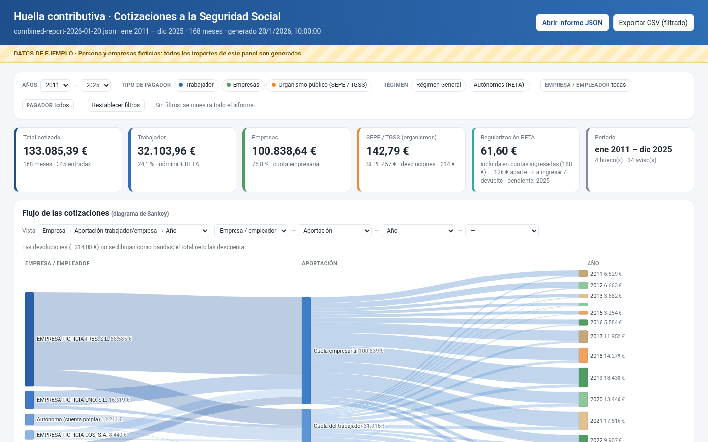

# Huella Contributiva

*A transparency and civic-awareness exercise: see every contribution to the Spanish state that your work has generated.*

[](example/dashboard.html)

Example dashboard with generated data: open [`example/dashboard.html`](example/dashboard.html) (download it and open it
in a browser) or [preview it online](https://htmlpreview.github.io/?https://github.com/gfelixc/huella-contributiva/blob/main/example/dashboard.html).
Every person, company and amount in it is fictitious.

Reads your Spanish Social Security and SEPE data with your own digital certificate (macOS Keychain), keeps every
result on your Mac, and exposes it as a CLI and as an MCP server (15 tools). Behaviour on the government sites is
read-only: queries and downloads, never requests, changes or submissions.

- the **work history** ("Tu vida laboral"), read directly from the Import@ss service page into JSON; the official
  PDF is downloaded only when you ask for it (`fetch --pdf` / `download_pdf: true`)
- the **contribution bases report** ("Informe de bases de cotización"): PDF, parsed locally into JSON
- the **quota calculations** query ("Consulta de cálculos de cuotas para trabajador")
- the **paid contributions report** for RETA / special regimes ("Informe de cuotas ingresadas")
- the **SEPE unemployment benefit certificates**
- the **RETA annual regularisation** of self-employed contributions ("Regularización de cuotas de autónomos")
- a **combined contributions report** (JSON) of everything paid by you, your employers or a public agency, and a
  local **HTML dashboard** built from it

> Independent open-source tool, not affiliated with or endorsed by the Social Security (TGSS), SEPE or any
> government body. Read-only, for your own data only. See [Disclaimer](#disclaimer) and [License](#license).

Privacy by design:
- Opens the **installed Google Chrome** (no bundled browsers) with a dedicated profile in `.chrome-profile/`. You pick
  the certificate yourself in the native picker; the tool **never reads, exports or copies** certificates or keys.
  Set `HUELLA_CERT_LABEL` if you want the tool to print which certificate to choose (kept out of the code).
- The work history and the bases report are saved twice: a **full JSON** (with identifying data, stays local) and an
  **anonymised JSON** (`.anon.json`, no identity block, leak-checked). Tools return only the full JSON's file name and
  the anonymised content.
- Tool responses and CLI output carry **file names only** (never absolute paths, which contain your username);
  `detail="full"` lists the local raw files instead of sending raw page/PDF text. See "Output hygiene".

Output folder `~/Documents/HuellaContributiva/` by default, or `HUELLA_OUTPUT_DIR` (see [Configuration](#configuration-environment-variables)). It contains your personal data; keep it private:

| Data | Files |
|---|---|
| Work history | `work-history-YYYY-MM-DD.json` (full) + `.anon.json`; page snapshots `work-history-YYYY-MM-DD-page[-N].txt/.html/.png`; with `--pdf` also `work-history-YYYY-MM-DD.pdf/.txt` |
| Contribution bases | `contribution-bases-YYYY-MM-DD[-partN].pdf/.txt` (one part per date-range chunk or extra `--keep-open` download) and one JSON pair per day: `contribution-bases-YYYY-MM-DD.json` + `.anon.json` |
| Quota calculations | `quota-calculation-YYYY-MM-DD-<YYYY-MM>[-liqN|-list].txt/.html/.png` per result page, `…-snapN.*` (`--keep-open`), `…-<label>-pdfN.pdf`, `quota-calculation-YYYY-MM-DD.txt`, `quota-calculation-YYYY-MM-DD.manifest.json`, `quota-calculation-YYYY-MM-DD.summary.csv/.json` |
| Paid contributions | `paid-contribution-YYYY-MM-DD-<year>[-error].txt/.html/.png`, the report PDF and its text, `…-snapN.*` / `…-manual-pdfN.*` (`--manual`/`--keep-open`), `paid-contribution.summary.csv/.json` |
| SEPE | `sepe-YYYY-MM-DD-annual-YYYY.pdf/.txt`, `sepe-YYYY-MM-DD-period-YYYYMM-YYYYMM.pdf/.txt`, `sepe-YYYY-MM-DD-manual-N.*`, page snapshots `…-page.txt/.html`, `sepe-benefits.summary.csv/.json` |
| RETA regularisation | `reta-regularisation-YYYY-MM-DD-<label>.pdf/.txt`, page snapshots `reta-regularisation-YYYY-MM-DD-<label>-page.*`, `reta-regularisation.summary.csv/.json` |
| Combined report | `combined-report-YYYY-MM-DD[-filtered].json` |
| Dashboard | `dashboard-YYYY-MM-DD.html` (report embedded), `dashboard-template.html` (empty template) |

## Requirements and installation
Requirements:
- **macOS** (the certificate is read by Chrome from the macOS Keychain; other systems are untested).
- **Node.js 22.13 or later** (`node --version`); Node 24 LTS is recommended. With nvm: `nvm install 24`.
- **Google Chrome** installed in `/Applications` (the tool drives the installed Chrome; it does not download a browser).
- Your own **Spanish digital certificate** (e.g. FNMT, persona física) installed in the macOS Keychain and working in
  Chrome on the Social Security e-office (login uses "DNIe o Certificado"; Cl@ve PIN / Cl@ve Móvil are not supported).

Install (no browser download, no build step):
```bash
git clone <repository URL> huella-contributiva   # or download and unzip the source
cd huella-contributiva
npm ci                                           # installs the exact versions in package-lock.json
npm test                                         # optional: offline tests (no browser, no network)
```

First run:
```bash
node cli.js refresh-all --dry-run   # what would be fetched (with no saved data: everything); no browser
node cli.js refresh-all             # opens Chrome once: pick your certificate when macOS asks, then wait
```
- On the first run the dedicated Chrome profile `.chrome-profile/` is created in the project folder and the output
  folder is created if missing. macOS may ask for permission to use the certificate's key: allow it for Chrome
  (only you can do this; the tool never reads the key).
- Keep the Chrome window open until the command ends; it closes Chrome itself. Use it from an AI assistant instead
  via the MCP server (see "MCP server (stdio)").

### Configuration (environment variables)
All optional; with none set the defaults below apply.

| Variable | Default | Purpose |
|---|---|---|
| `HUELLA_OUTPUT_DIR` | `~/Documents/HuellaContributiva` | Output folder (created if missing). `~/…` and relative paths are accepted. Output shows it as `~/…` (inside your home folder) or only its folder name, never an absolute path. |
| `HUELLA_CHROME_PROFILE` | `<project>/.chrome-profile` | Dedicated Chrome profile folder (cookies of the e-office sessions; never your normal Chrome profile). |
| `HUELLA_CERT_LABEL` | (none) | Only a hint: the tool prints "choose <label>" when the certificate picker appears. |
| `HUELLA_TEST_REAL_DATA` | (none) | `1` runs the opt-in test against your own saved bases report. |

Example: a separate test folder and profile, without touching your normal data:
```bash
HUELLA_OUTPUT_DIR=~/Documents/HuellaContributiva-test HUELLA_CHROME_PROFILE=~/huella-test-profile node cli.js refresh-all --dry-run
```

## Architecture
The C4 model diagrams (Mermaid) and their explanations are in [C4_MODELS.md](C4_MODELS.md):
- [Level 1: System context](C4_MODELS.md#level-1-system-context): the user, the AI assistant (MCP client), the local
  tool, the Keychain, the output folder and the government e-offices.
- [Level 2: Containers](C4_MODELS.md#level-2-containers): CLI, MCP server, output guard, core modules, Chrome and the
  data stores (full data, anonymised JSON, combined report, dashboard).
- [Level 3: Components](C4_MODELS.md#level-3-components): every module in `src/` and `dashboard/` and the data
  flowing between them.
- [Dynamic view: `get_work_history_report`](C4_MODELS.md#dynamic-view-get_work_history_report): the sequence of one
  work history fetch, from the tool call to the sanitised response.
- [Dynamic view: `refresh_all_and_dashboard` / `refresh-all`](C4_MODELS.md#dynamic-view-refresh_all_and_dashboard--refresh-all):
  the one-command refresh: plan, one Chrome session, fetchers, combined report, dashboard.

### What reaches the LLM and what stays local
| Reaches the MCP client / LLM | Stays on the Mac only |
|---|---|
| Anonymised work history and bases JSON (no identity block, absolute paths reduced to file names, identity values redacted) | Full JSON files with the `identity` block (name, ID document, Social Security number, birth date and address when the PDF prints them, document verification code) |
| Compact tables and totals computed from the saved files (quotas, paid contributions, SEPE, regularisation, combined report) | Raw page snapshots (.txt/.html/.png) and PDFs and their text |
| File names (e.g. `fullJsonFile`, `csv=`, `report=`, `rawFiles`), the folder as the literal `~/Documents/HuellaContributiva` | Absolute paths (they contain `/Users/<user>/`) |
| Notes, gaps and data-quality messages | The certificate and its private key (never read by the tool at all) |

The summary/breakdown views are built from structured fields, not from raw text. The paid contributions breakdown
also shows each row's own report line (at most 200 characters of that table row). Employer names and CCCs (employer
codes) are kept in the outputs and in the anonymised copies; they are employer data.

## Flows
Button labels below are the Spanish labels shown on the website.

### Work history (page → JSON)

1. Opens the official procedure page:
   https://portal.seg-social.gob.es/wps/portal/importass/importass/Categorias/Vida%20laboral%20e%20informes/Informes%20sobre%20tu%20situacion%20laboral/Informe%20de%20tu%20vida%20laboral
2. Clicks **Consultar vida laboral** (→ `/wps/myportal/importass/importass/tramites/datosvidalaboral`).
3. On the identification screen clicks **DNIe o Certificado** → choose your personal certificate (set `HUELLA_CERT_LABEL` to have the tool print its label).
4. On the service page ("Tu vida laboral") it expands every period row: only the accordion buttons in the title
   cells of the table, never **Descargar vida laboral**, **Informar error**, **Filtrar por empresa o fecha**, the
   header exit/logout or anything in the global blocklist. If the listing shows more than one page ("1 de N") it
   clicks the pagination "next" control (read-only) and reads every page.
5. Saves a snapshot of each page (`work-history-YYYY-MM-DD-page[-N].txt/.html/.png`) and writes:
   - `work-history-YYYY-MM-DD.json`: everything, including the identifying data;
   - `work-history-YYYY-MM-DD.anon.json`: the same without identifying data (no `identity` block, file names
     instead of absolute paths, and any identity value found elsewhere replaced by `[redacted]`; a final check
     refuses to write files if one is still present).
6. Only with `fetch --pdf` / MCP `download_pdf: true` it then clicks **Descargar vida laboral**, saves
   `work-history-YYYY-MM-DD.pdf/.txt`, and adds the identifying data printed in the PDF to the full JSON.
7. Closes Chrome.

The tools return `{ok, folder, fullJsonFile, workHistory}` (plus `pdfFile` when the PDF was requested): the
folder label, the file name of the full JSON and the content of the anonymised JSON; never the page text, the
PDF text or identifying values. Identifying data: the page itself only shows the display name in the header
(link to the personal area); the PDF also prints the full name, birth date, Social Security number, ID document and
address. Employer codes (CCC) in the filter list are employer data and are kept.

JSON fields (`schemaVersion` 1):
- `source`: `url`, `page` (`AFPH02VidaLaboral`), `method` (`service-page`), `fetchedAt`, `pages`, `pdf`
  (`{pdfPath, txtPath}` or null).
- `identity` (full JSON only): `displayName`, `fullName`, `birthDate`, `socialSecurityNumber`, `idDocument`,
  `idDocumentType`, `address`, `sources`.
- `summary`: `totalDaysRegistered`, `simultaneousDays`, `computableDays`, `computableDuration {years, months, days}`.
- `regimes`, `employers [{name, ccc}]` (from the page's filter list), `pagination {current, total}`.
- `periods[]`: `index`, `page`, `title`, `prefix` (e.g. `VACACIONES RETRIBUIDAS Y NO DISFRUTADAS`), `company`,
  `ccc`, `situationType` (`employment` | `self-employed` | `unemployment-benefit` | `paid-untaken-vacation` |
  `special-agreement`), `benefitKind` (`erte-suspension` | `erte-reduction` | `unemployment` | null), `regime`,
  `trl`, `contract`, `workday`, `contributionGroup`, `effectDate`, `startDate`, `endDate` (null while current),
  `current`, `days`. Dates are ISO `YYYY-MM-DD`; "Sin datos" becomes null.
- Anonymised copy only: `anonymized: true`, `removed`.

The SEPE fetch (default years), `show-sepe`, `sepe-plan` and the combined report take the benefit periods from the
newest work history JSON; if only an older PDF report is saved they fall back to its text.

### Contribution bases report
1. Opens the official procedure page:
   https://portal.seg-social.gob.es/wps/portal/importass/importass/Categorias/Vida+laboral+e+informes/Informes+de+tus+cotizaciones/Informe+de+bases+de+cotizacion
2. Clicks **Consultar bases** (→ `/wps/myportal/importass/importass/tramites/informebases`).
   "Consultar como apoderado" is never clicked.
3. Same certificate login as above (**DNIe o Certificado**).
4. Optional date range (`--from/--to`): fills the from/to date fields (**Desde/Hasta**,
   **Fecha inicio/fin**), clicks **Filtrar/Aplicar/Buscar**, then downloads. With
   `--chunk-years N` it repeats this for each chunk, saving one PDF per part. If the
   date filter cannot be found it falls back to the complete (unfiltered) report.
5. Clicks **Descargar** (selecting the "completo" option if a dialog offers it) and
   captures the PDF.
6. Parses the text of every downloaded part locally and writes one JSON pair for the day:
   - `contribution-bases-YYYY-MM-DD.json`: everything, including the identifying data;
   - `contribution-bases-YYYY-MM-DD.anon.json`: without identifying data (no `identity` block, file names instead of
     absolute paths, any identity value found elsewhere replaced by `[redacted]`; nothing is written if the final
     leak check fails). Monthly cells are compact here (see below).

The tools return only `{ok, folder, fullJsonFile, pdfFiles, contributionBases}`: the folder label, the file name of
the full JSON, the PDF file names and the anonymised JSON; never the PDF text or identity values. If only an older report text (no JSON) is
saved, `show-bases` / `read_latest_contribution_bases_report` and every consumer first build the JSON pair from it
(local parsing). Identifying data in the report header: full name, Social Security number, ID document (type and
number) and the document's verification code ("Código", which lets anyone retrieve the PDF). The header has no birth
date or address.

JSON fields (`schemaVersion` 1, `kind: "contribution-bases"`):
- `source`: `report`, `method` (`pdf-text`), `fetchedAt`, `issueDate`, `requestedFrom`/`requestedTo` (`YYYY-MM`),
  `parts[]` (`part`, `pdfPath`, `txtPath`, `title`, `issueDate`, `verifiableUntil`, `requestedFrom`, `requestedTo`,
  `pages`, `sections`).
- `identity` (full JSON only): `fullName`, `socialSecurityNumber`, `idDocument`, `idDocumentType`, `verificationCode`,
  `otherVerificationCodes` (other parts), `sources`.
- `legend`, `regimes`, `employers [{name, ccc, regime}]`.
- `sections[]`: `regime`, `employer`, `ccc`, `selfEmployed`, `part`, and in the full JSON
  `months [{year, month, status (base | no-base | pending | none), base, provisional}]`. The report prints one
  base per month and employer: no split by contingency and no days.
  In the anonymised copy `months` is replaced by `years: {"YYYY": [12 cells]}`, January first: number = base,
  `"N*"` = provisional base, `null` = "---", `"no-base"`, `"pending"` (`monthCells` describes it).
- `totals` (computed; the report prints none): per section (`firstMonth`, `lastMonth`, `monthsWithBase`,
  `monthsNoBase`, `monthsPending`, `provisionalMonths`, `sumBases`), `byYear`, `sumBases`, `employeeMonths`,
  `selfEmployedMonths`, `lastReportMonth`, `selfEmployedActiveAtEnd`.
- Anonymised copy only: `anonymized: true`, `removed`, `monthCells`.

Without `--from/--to`, the site's complete report (all periods) is downloaded, which
is the recommended default for the whole working life.

### Quota calculations (read-only)
1. Opens the official procedure page:
   https://portal.seg-social.gob.es/wps/portal/importass/importass/Categorias/Vida+laboral+e+informes/Informes+de+tus+cotizaciones/Consulta+de+calculos+de+cuotas+para+trabajador
2. Clicks **Consultar cálculos** once. It opens a **new tab**
   (`/wps/portal/importass/Seguridad/PortalRedirectorN1P?idApp=363&N1&P`) with the legacy online service.
   "Consultar cálculos como apoderado" is never clicked.
3. Same certificate login as above (**DNIe o Certificado**) if the session is not reused.
4. Month selection: by default only the months worked as an **employee** (any regime other
   than RETA/self-employed) are queried. They come from the full JSON of the latest saved
   contribution bases report (`contribution-bases-YYYY-MM-DD.json`, via `loadContributionBases()`; built first from a
   newer saved report text if needed): a month counts when its cell holds a base or "Sin base registrada"; "---"
   means no registration. Overlapping months (job changes) are
   queried once and list every employer. If no bases report is saved, or with
   `--refresh-bases`, the bases report is downloaded first in the same browser session.
   `--range` selects one or more ranges (repeat the flag or comma-separate; each range is
   `MM/YYYY-MM/YYYY` or `YYYY-MM-YYYY-MM`, no spaces); `--from/--to` still works as one more range.
   Range months are limited to employee months unless `--all-months`.
   `--months` adds individual months (MM/YYYY or YYYY-MM, comma or space separated). Alone it
   queries exactly those months (even if they are not employee months; a note is logged); with
   ranges (or `--all-months`) the union of all selections is queried (de-duplicated, sorted),
   all in one browser session, so the certificate is asked at most once.
   `--from/--to` filter the list; `--all-months` queries every month instead
   (default 05/2023 → last month). `node cli.js employee-months` shows the list without a browser.
5. For each selected month: fills the period selector (**Mes/Año** or
   **Periodo**), clicks **Aceptar** (the query button of the period screen, the only "Aceptar"
   the tool ever clicks), and if several liquidations are listed opens each with **Continuar**.
   It saves the "cálculos globales" result page as .txt/.html/.png, clicks a
   **Descargar/Imprimir/PDF** option if one exists, then goes back with **Atrás**.
   Months without a liquidation ("No existe liquidación…") are recorded as "no data".
6. If the period selector is not detected, or with `--manual`/`--keep-open`, it switches to
   snapshot mode: every new result page you open is saved until you close the window.

Months with several liquidations: the live list page links each row ("Seleccione la liquidación N").
Result pages have no "Atrás" button and the browser Back button shows a "Confirm Form Resubmission"
error, so for liquidation 2, 3… the tool re-runs the month query from the form and clicks link N on the
fresh list; it never goes back or reloads. Each fetch of a month is recorded in
`quota-calculation-YYYY-MM-DD.manifest.json`, and the summary uses only the files of that month's latest fetch
(older snapshots of the same month are ignored, duplicates are dropped; liquidations that could not be
opened appear as `not-opened`).

Extra blocklist for this service: anything about payments, direct debit, deferrals, refunds,
changes of base/income, requests, confirmations, submissions or deletions is never clicked.

Note: according to the official manual this service shows the calculations of liquidations filed
by an employer through SLD / RED Directo (employees), which is why only employee months are
queried by default. The combined summary shows the employer (and CCC) of each month.

If an automatic click fails, the window stays open: navigate manually and the tool keeps
waiting (5 min by default) until a PDF appears. It never clicks "Recibir informe en mi
domicilio" or any other request/submission.

### Paid contributions report for RETA / special regimes (read-only)
1. Opens the official procedure page:
   https://portal.seg-social.gob.es/wps/portal/importass/importass/Categorias/Vida+laboral+e+informes/Informes+de+tus+cotizaciones/Informe+de+cuotas+ingresadas
2. Clicks **Solicitar informe** once ("Solicitar informe como apoderado" is never clicked). An
   identification-method popup appears; the tool keeps the default option ("Tengo Cl@ve…, Certificado
   Electrónico…") and clicks its **Continuar**, which opens a **new tab**
   (`/wps/portal/importass/Seguridad/PortalRedirectorN1P?idApp=110&N1&P`, "Informe de bases y cuotas ingresadas").
   The "Ninguno de los anteriores" path (selfie/ID upload) and "Recibir informe en mi domicilio" are never used.
3. Same certificate login (**DNIe o Certificado**) if the session is not reused.
4. The site issues the report **per year** (data since 1999): for each year of the selected months it selects
   the year (**Año/Ejercicio**), clicks **Continuar** (or **Aceptar/Consultar**), saves the result page and
   clicks **Imprimir** to capture the certified PDF, then re-opens the form URL (never the browser Back button).
   Everything runs in one browser session.
5. Month selection: by default every **self-employed (RETA)** month in the latest saved contribution bases
   report up to last month (if the registration is still active at the end of the report, the months not yet
   in it are added up to last month). No saved bases report, or `--refresh-bases`: it is downloaded first in the
   same session. `--range` (repeatable / comma separated) and `--from/--to` limit it to self-employed months in
   any range (`--all-months`: every month of the ranges); `--months` adds individual months, requested even if
   they are not RETA months (a note is printed). The selection decides which years are requested and which rows
   are shown; selected months without a row are listed as `missing`. `node cli.js paid-months` previews it.
6. Parsing: the result-page table is mapped by its header (Periodo, Régimen, Base, Cuota, Recargo, Intereses,
   Fecha, Estado, when shown); the PDF text is the fallback. Per year the newest capture wins (page > PDF > manual
   snapshot); a page without rows never replaces earlier rows unless it says there is no data.
7. Never clicked: payments, direct debit, deferrals, refunds, changes, requests, confirmations, submissions
   (same blocklist as the quota calculations), nor "Salir"/logout.

### SEPE unemployment benefit certificates (read-only)
`node cli.js fetch-sepe` / MCP `get_sepe_benefits_certificate` download the SEPE "Certificados de prestaciones"
(the worker contribution SEPE deducts from unemployment benefits, e.g. during an ERTE, is not in the Import@ss reports).

1. `https://sede.sepe.gob.es/DServiciosPrestanetWEB/CertificadosPrestaWeb.do` → link "Certificado digital, DNI
   electrónico o usuario Cl@ve" (→ `TipoAutenticadoAction.do` → `isweb.sepe.gob.es` login).
2. "Certificado digital o DNI electrónico" → Cl@ve gateway (`pasarela.clave.gob.es`) → DNIe / certificado electrónico;
   **you pick your certificate in the macOS picker** (never Cl@ve PIN/permanente/móvil, never eIDAS or registration).
3. Types list: "De importes anuales" → "Ejercicio" select → ACEPTAR (one per year), and optionally "De importes por
   período" → Desde/Hasta (mm/yyyy, max 12 months) → ACEPTAR.
4. "Datos de solicitud": the tool checks **"Desea descargarlo desde internet"** (and verifies the postal option is not
   checked) → MOSTRAR → "Obtención del certificado" → OBTENER → PDF.

The entry page shows a full-page cookie banner (`.cookies-veil`, fixed, z-index 5000) until it is answered; it
intercepts every click. The tool answers it with «Rechazar todas» (declines optional cookies only) or hides it locally,
then clicks the access link, and if that click still fails it opens the link's own `href`
(`https://sede.sepe.gob.es/DServiciosPrestanetWEB/TipoAutenticadoAction.do`, validated host and path) directly.

Safety: the postal option ("recibirlo por correo al domicilio") would continue with "datos de envío" and CONFIRMAR;
the tool never selects it and stops if such a screen appears. It never clicks requests (solicitudes, presolicitud),
changes, de-registration (bajas), appointments (cita previa), address, bank account, job-seeker renewal (renovar
demanda), sign/submit/confirm buttons or logout. `--manual` makes no clicks at all.

Selection: `--years`, `--range`, `--from/--to`, `--months` (their years), `--all-years`; default = the years of the
unemployment benefit periods in the saved work history JSON (`situationType: unemployment-benefit`, e.g.
`PRESTACION DESEMPLEO. SUSPENSION`; older PDF text as a fallback),
else 2020. `--period MM/YYYY-MM/YYYY` (or `auto` = first benefit period) also requests one period certificate; the site
issues one period certificate per day, so the tool skips it when one was already saved today.

Output (`~/Documents/HuellaContributiva`): `sepe-YYYY-MM-DD-annual-YYYY.pdf/.txt`, `sepe-YYYY-MM-DD-period-YYYYMM-YYYYMM.pdf/.txt`,
`sepe-YYYY-MM-DD-<step>-page.txt/html/png` when a step fails, and `sepe-benefits.summary.csv/.json`
(columns `kind year period_from period_to status benefit_type gross irpf ss_deduction reass net source`).
Limits: the certificates contain totals for the year/period only (gross, "abono cuota fija REASS", IRPF withheld,
Social Security deduction), no monthly breakdown (that would need the "Área personal" payment slips, not implemented).
PDF layouts are parsed heuristically (same-line or column layout); unparsed certificates are listed separately.

### RETA annual regularisation (read-only)
Since 2023 self-employed (RETA) contributions are paid on provisional bases chosen from the expected net income. Once the
tax agency reports the real net income, the Social Security regularises the year (art. 308.1.c LGSS; RD 2064/1995
art. 46 as amended by RD 665/2024): year Y is regularised during Y+1 / early Y+2. The result is a **refund** (paid by the
TGSS, by 30 April of the following year), an **amount to pay** (due by the last day of the month after the notification)
or **no difference** (the provisional bases become definitive). Flat-rate months and months with a benefit are not
regularised.

`node cli.js fetch-regularization` / MCP `get_reta_regularization` read the result on Import@ss:
- current service: `https://portal.seg-social.gob.es/wps/portal/importass/importass/tramites/consultaRegularizacionAutonomos`
- previous years ("años anteriores"): `https://portal.seg-social.gob.es/wps/myportal/importass/importass/tramites/regularizacionCuotasAnyosAnteriores`
- background: `https://portal.seg-social.gob.es/wps/portal/importass/importass/Categorias/consulta+de+pagos+y+deudas/pagosdevoluciones_/regularizacionreta`

Steps (automatic mode, the default): certificate login → straight to the "años anteriores" page
(`RALI05RegularizacionHistorico`) → snapshot → its result cards are parsed (one per year: `Resolución <year>`, regime,
year, and `A ingresar: X €` / `A devolver: X €` / `Sin diferencias`; `Resolución no dispobible` [sic] when there is no
PDF) → for each requested year the tool clicks only the allowlisted `<button name="accion" value="DESCARGAR">Resolución
<year></button>` and captures the PDF (download event, PDF response, a blob URL created by the page, or a new tab on a
blob/data PDF) → `reta-regularisation-YYYY-MM-DD-<year>.pdf/.txt` → Chrome is closed (unless `--keep-open`). The site's
`descargaDoc(this, "<portlet URL with anio!<year> … accion!DESCARGAR>")` fetches the PDF and saves it through a blob
link. Per click the capture state is reset (earlier captures handled first, old blob URLs dropped, the page reloaded
before every further click, the page's own download guard idle), and only a NEW PDF is accepted; after 12 s without one
the tool sends the same GET request directly. Every PDF is checked before it is saved: the same bytes as another year's
PDF (stale capture) or a resolution title naming another year ("RESOLUCIÓN SOBRE BASE DE COTIZACIÓN DEFINITIVA DEL AÑO
<year>") is rejected and logged (a late download of another requested year is kept for that year); a PDF without a
recognisable year is saved as `…-unverified-<year>.pdf`. After the last click a 5 s grace period checks downloads still
in flight. The
current-year service (`consultaRegularizacionAutonomos`, `TRIA01RegularizacionAutonomos`) is a "Vas a solicitar una
consulta" submission form: it is never filled or submitted, automatic mode does not open it, and if a login lands on it
the tool moves on to "años anteriores"; saved snapshots of it (and of the public information page) are ignored as data
sources. `--manual` clicks nothing after the login (you navigate; every page mentioning "regularización" and every PDF is
saved); `--keep-open` adds that snapshot mode after the automatic steps.

Safety (strictly read-only):
- The only button clicked on the service page is the resolution download described above (explicit allowlist:
  `button`, `value="DESCARGAR"`, text exactly `Resolución <requested year>`, not disabled).
- Never clicked (Spanish labels, on top of the global blocklist): mantener base / optar / opción / anular / renunciar,
  pagar / pago / tarjeta / documento de pago / ingresar, formular consulta / preguntar / solicitar / reclamar / recurso /
  alegaciones, banco / cuenta / IBAN / domiciliación, apoderado / representante, confirmar / aceptar / firmar / enviar /
  guardar / modificar, alta / baja, salir / cerrar sesión.
- Electronic notifications are **never** opened: any navigation to NOTESS, DEHú or a notifications page is aborted and
  links mentioning "notificación" / "buzón" are never clicked (opening a notification counts as legal receipt and
  starts the deadlines). The service shows a result only after the notification was read or 10 days after it was issued.

Output (`~/Documents/HuellaContributiva`): `reta-regularisation-YYYY-MM-DD-<year>.pdf/.txt` (resolution PDFs, named by the
year found in the text, else `manual-N`), `reta-regularisation-YYYY-MM-DD-<label>-page.txt/html/png` (every page
visited) and `reta-regularisation.summary.csv/.json` (columns
`year status amount signed_amount due_date refund_date resolution_date net_income payment_status payment_evidence
definitive_base months resolution_pdf source`; status `refund` |
`claim` | `no-difference` | `not-regularisable` | `pending` | `unknown`; signed amount: claim positive, refund negative).
`show-regularization` / `read_latest_reta_regularization` re-parse the saved files (latest day with a result per year).
The card of the "años anteriores" page gives the status and amount (even without a PDF); the resolution PDF text adds the
due date, refund date, net income, definitive base, monthly bases and payment information (`paymentInfo`), and a PDF
amount that differs from the card is flagged for checking. From the resolution PDF: the monthly table "Cuotas por bases
provisionales | Cuotas por bases definitivas | Resultado de la regularización | Información adicional" (`months[]`:
`period`, `provisionalQuota`, `definitiveQuota`, `difference`, `info`) and its `TOTAL` row (`totals`), the definitive base,
the average provisional base, the resolution date, a sanitised payment summary (`paymentInfo`; account and reference
numbers of the payment document are never extracted) and the income lines (`income`: declared income, deducted quotas,
generic deduction, annual computable income, and the monthly computable income as printed, flagged
`monthlyComputableIncomeInconsistent` when it exceeds the annual figure). Income figures are kept in the summary files and
never logged. `paymentStatus` comes from evidence only: `paid` / `refunded` when the paid contributions report already
shows the definitive quota of every month with a difference (`paymentEvidence`), `partly reflected`, or `not reflected in
the paid report`; words such as "podrá ser ingresado" in the letter are not evidence; `regularization-plan` lists the years and services without a browser. Explicit `--years`
must be between 2023 and last year. Limits: the parser is heuristic until real pages have been saved; unrecognised
pages are listed as `unknown` and kept for review.

### Combined contributions report (no browser)
`node cli.js contributions-report` / MCP `get_contributions_report` combine the saved data:

| Months | Source | Entries per liquidation | Channel |
|---|---|---|---|
| employee (GENERAL…) | quota calculations (`quota-calculation-*`) | worker share (payer `self`) + employer share (payer = employer, CCC) | `payroll withholding` / `employer settlement` |
| self-employed (RETA) | paid contributions (`paid-contribution-*`) | one, payer `self` | `direct payment` |
| unemployment benefit periods (ERTE…) | SEPE certificates (`sepe-*`) | one per certificate, payer `SEPE` (`public_agency`), `month: null`, `periodFrom`/`periodTo` | `deducted from unemployment benefit` |
| RETA annual regularisation | `reta-regularisation.summary.*` | reconciled per month with the paid contributions report (see below); one entry per year only for the unreconciled remainder: amount to pay = payer `self` (`worker`), positive; refund = payer `TGSS` (`public_agency`), negative; `month: null`, `periodFrom`/`periodTo` = the year's RETA months, `via` `self-employed`, `liquidationType` `REGULARIZATION` | `regularization payment` / `regularization refund` |

The bases report (`contribution-bases-*`) supplies the expected months (gaps) and each month's base
(`basesReportBase`, data-quality notes). Output: `~/Documents/HuellaContributiva/combined-report-YYYY-MM-DD.json`
(`…-filtered.json` when a filter is used). `--refresh` (MCP `refresh: true`) first fetches the months listed as
gaps in ONE Chrome session (quota calculations and/or paid contributions; bases report first if none is saved).

Structure (synthetic example, amounts in EUR):
```json
{
 "reportVersion": 1, "generatedAt": "2025-10-10T08:00:00.000Z", "currency": "EUR",
 "selection": { "ranges": null, "from": null, "to": null, "months": null, "payer": "all", "payerName": null },
 "sources": { "basesReport": "contribution-bases-2025-10-10.json",
              "quotaCalculations": { "day": "2025-10-10", "summary": "quota-calculation-2025-10-10.summary.csv" },
              "paidContributions": { "summary": "paid-contribution.summary.csv", "years": { "2025": { "status": "ok" } } },
              "sepeBenefits": null, "workHistory": "work-history-2025-10-10.json", "retaRegularization": null },
 "coverage": { "from": "2025-01", "to": "2025-07", "months": 7, "monthsByRegime": { "GENERAL": 3, "RETA": 5 }, "entries": 13 },
 "aggregates": {
  "byPayer": [ { "payerType": "employer", "payerName": "EXAMPLE COMPANY, S.L.", "ccc": "00000000000", "entries": 4, "amount": 1950, "surcharge": 0, "total": 1950, "months": 3 },
               { "payerType": "worker", "payerName": "self", "channel": "payroll withholding", "entries": 4, "amount": 420, "surcharge": 0, "total": 420, "months": 3 },
               { "payerType": "worker", "payerName": "self", "channel": "direct payment", "entries": 5, "amount": 1060, "surcharge": 0, "total": 1060, "months": 5 } ],
  "byPayerType": [ { "payerType": "worker", "total": 1480, "...": "..." }, { "payerType": "employer", "total": 1950, "...": "..." } ],
  "byYear": [ { "year": 2025, "entries": 13, "amount": 3430, "surcharge": 0, "total": 3430, "months": 7 } ],
  "byYearPayer": [ { "year": 2025, "payerType": "employer", "payerName": "EXAMPLE COMPANY, S.L.", "ccc": "00000000000", "total": 1950, "...": "..." } ],
  "byRegime": [ { "regime": "GENERAL", "total": 2370, "...": "..." }, { "regime": "RETA", "total": 1060, "...": "..." } ],
  "byChannel": [ { "channel": "payroll withholding", "total": 420, "...": "..." } ],
  "grand": { "entries": 13, "amount": 3430, "surcharge": 0, "total": 3430, "months": 7 }
 },
 "gaps": [ { "period": "2025-08", "regime": "RETA", "reason": "self-employed month missing from the paid contributions report" } ],
 "notes": [ { "type": "base-mismatch", "period": "2025-03", "regime": "GENERAL", "ccc": "00000000000",
              "message": "quota calculation base 1800 vs bases report 2000 (diff -200)", "sourceFile": "quota-calculation-2025-10-10-2025-03.txt" },
            { "type": "reduced-quota", "period": "2025-05", "periodTo": "2025-06", "regime": "RETA", "message": "2025-05..2025-06 quota 80 on base 1000 = 27% of the full rate (reduction / bonus / flat rate?)" } ],
 "payments": [
  { "id": 1, "year": 2025, "month": 1, "period": "2025-01", "regime": "GENERAL", "regimeCode": "0111",
    "employer": "EXAMPLE COMPANY, S.L.", "ccc": "00000000000", "liquidationNumber": 1, "liquidationType": "L00", "liquidationLabel": "NORMAL",
    "base": 2000, "basesReportBase": 2000, "surcharge": null, "sourceReport": "quota-calculations", "sourceFile": "quota-calculation-2025-10-10-2025-01.txt",
    "payerType": "worker", "payerName": "self", "channel": "payroll withholding", "amount": 130, "total": 130 },
  { "id": 2, "...": "same month, payerType employer, payerName EXAMPLE COMPANY, S.L., channel employer settlement, amount 600" },
  { "id": 9, "year": 2025, "month": 4, "period": "2025-04", "regime": "RETA", "regimeCode": "RETA", "payerType": "worker", "payerName": "self",
    "employer": null, "ccc": null, "channel": "direct payment", "liquidationNumber": 1, "liquidationType": null, "liquidationLabel": null,
    "base": 1000, "basesReportBase": 1000, "amount": 300, "surcharge": 0, "paymentDate": null, "paymentStatus": null,
    "sourceReport": "paid-contributions", "sourceFile": "paid-contribution-2025-10-10-2025.txt", "total": 300 }
 ]
}
```
Payment fields: `year`, `month`, `period` (YYYY-MM), `regime` (GENERAL/RETA/…), `regimeCode` (as in the source),
`payerType` (`worker` | `employer` | `public_agency`), `payerName` (employer name or `self`), `employer`/`ccc` (the employer of an employee
month, also on the worker-share entry), `channel` (`payroll withholding` | `employer settlement` | `direct payment`),
`liquidationNumber`, `liquidationType` (L00, L13…), `liquidationLabel`, `base` (from the source report), `basesReportBase`,
`amount`, `surcharge` (RETA surcharge + interest), `total` (amount + surcharge), `paymentDate`/`paymentStatus` (RETA, if
shown), `sourceReport` (`quota-calculations` | `paid-contributions` | `sepe-benefits` | `reta-regularization`), `sourceFile`, `via` / `viaType` (the employment the entry belongs to: employer name + `employer`, `self-employed`, or `SEPE` + `public_agency`; also set on worker-share entries), `benefitOverlap`
(benefit period kind when the month is inside an unemployment benefit period of the work history report). SEPE entries
also carry `grossBenefit`, `irpfWithheld`, `netBenefit`; their `amount` is the Social Security deduction. Annual
certificates are preferred; a period certificate of the same year only adds a `sepe-period-certificate` note (no double
counting). Entries with `month: null` are not counted in month totals. RETA regularisation reconciliation: when the resolution's monthly table is saved, each month with a difference is
compared with the paid contributions report; if the paid quota already equals the definitive quota (within 0.01) the
difference is already included there, so no separate entry is added and the month is annotated (`baseStatus`
`regularised`, `regularization: { year, includedDifference, provisionalQuota, definitiveQuota }`, a `regularised-month`
note). Only the unreconciled remainder becomes a regularisation entry (without a monthly table: the whole result).
Monthly RETA entries from 2023 carry `baseStatus`: `provisional` (no regularisation result saved yet), `regularised`,
`superseded` (adjusted by a difference not yet in the paid report; `regularizationYear`) or `definitive` (no difference /
not regularisable). The `reta-regularization` note carries `includedInPaid`, `remainder`, `reconciledMonths`,
`openMonths`, `paymentStatus` and `paymentEvidence`. Regularisation entries carry `dueDate`, `refundDate`,
`paymentStatus`; refunds are negative, so the grand total is the net amount.
Note types: `base-mismatch` (source base differs from the bases report; for employee months the normal liquidation's base
or the sum of the month's liquidations must match), `reduced-quota` (RETA quota well below the year's full rate: flat rate,
bonus, leave…), `provisional-base`, `multiple-activity` (employee and RETA in the same month), `quota-not-ok`,
`benefit-period` (ERTE / unemployment benefit months from the work history report, and whether SEPE data is included),
`sepe-period-certificate`, `reta-regularization` (result per year: status, amount, dates, reconciliation), `regularised-month`, `regularization-pending`
(a RETA year from 2023 up to last year without a saved result).
Gaps: employee months of the bases report without a quota calculation and RETA months (up to last month) without a paid row.

MCP output is compact by default: coverage, employers once (`E1`…), totals by payer type / payer / year, grand total,
gaps and notes, plus `report=<file name>` of the JSON written. `group_by` adds `year_payer`, `regime`, `month` (or `all`); `include_payments: true`
adds one line per entry. Filters: `ranges`, `months` (union), `payer` (`all`|`worker`|`employer`|`public_agency`), `payer_name`.

### Local dashboard (HTML, no browser automation)
`node cli.js dashboard [--open]` / MCP `get_contributions_dashboard` write a self-contained HTML file that opens from
`file://` (no server, no CDN, no network requests; a Content-Security-Policy blocks remote loads).

#### How to generate the dashboard and open it in the browser
**One command (recommended).** Fetches only what is missing or stale, builds the combined report, writes the
dashboard and opens it in the default browser:
```bash
node cli.js refresh-all --dry-run   # see the plan first: no browser, no fetch
node cli.js refresh-all             # aliases: `node cli.js all`, `node cli.js dashboard --refresh-all`
```
- **One Chrome window** for every step, so you pick the certificate once in the system dialog (the SEPE site is a
  different host and may ask for it again). Chrome opens only if at least one step has something to fetch.
- **Order:** contribution bases → work history → quota calculations → paid contributions → RETA regularisation → SEPE
  certificates. Each step is planned again just before it runs (a new bases report can add quota months; a new work
  history can add SEPE years).
- **Missing or stale:**

  | Step | Fetched when |
  |---|---|
  | Contribution bases, work history | nothing saved, or the latest was saved more than `--max-age` days ago (default 7) |
  | Quota calculations | nothing saved: all employee months; otherwise only the employee months without a quota calculation (months already queried without data are not retried) |
  | Paid contributions | nothing saved: all self-employed months; otherwise the self-employed months missing from the report (not the month just finished, usually not processed yet) |
  | RETA regularisation | the RETA years (from 2023) without a final result (refund, claim, no difference, not regularisable) |
  | SEPE certificates | the benefit years (from the work history) without a saved annual certificate |

- **Options:** `--force` (refetch every step), `--only <steps>` / `--skip <steps>` (comma-separated: `bases`,
  `work-history`, `quotas`, `paid`, `regularisation` or `reta`, `sepe`), `--max-age <days>`, `--no-open`, `--dry-run`,
  `--json`.
- **A failed step does not stop the others.** The output has one line per step (`ok` / `skipped` / `failed` /
  `planned` + reason, file names only; in a dry run `conditional` marks a step decided only after an earlier planned
  step fetches its input, e.g. the RETA years come from the bases report), then `report=… dashboard=…`. The exit code is non-zero if the dashboard could
  not be written.
- Everything stays read-only: the existing fetchers and their blocklists do the work (no payments, confirmations,
  submissions, form changes, representative mode or notifications).
- From an AI assistant (MCP): `refresh_all_and_dashboard` with `dry_run`, `force`, `only`, `skip`, `max_age_days` and
  `open` (default `true`).

**Step by step** (the same, by hand):
1. **Save your data first** (each step opens Chrome and needs your certificate; see "Usage (CLI)"). The dashboard shows
   whatever has been saved in `~/Documents/HuellaContributiva`; the more sources, the more complete it is:
   ```bash
   node cli.js fetch-bases            # contribution bases report: expected months, bases (recommended first)
   node cli.js fetch-quotas           # quota calculations: employee months (worker + employer shares)
   node cli.js fetch-paid-quotas      # paid contributions: self-employed (RETA) months
   node cli.js fetch                  # work history: unemployment benefit (ERTE) periods
   node cli.js fetch-sepe             # SEPE benefit certificates (contributions deducted from benefits)
   node cli.js fetch-regularization   # RETA annual regularisation (claims / refunds)
   ```
2. **Build the combined report** from the saved data (no browser):
   ```bash
   node cli.js contributions-report   # writes combined-report-YYYY-MM-DD.json
   ```
   Optional: `--refresh` first fetches the months listed as gaps in one Chrome session. Filters (`--range`,
   `--months`, `--payer`, `--payer-name`) write `combined-report-YYYY-MM-DD-filtered.json` instead.
3. **Generate the dashboard** (no browser automation):
   ```bash
   node cli.js dashboard                                          # embeds the latest combined-report-YYYY-MM-DD.json
   node cli.js dashboard --regenerate                             # rebuilds the combined report from saved data first
   node cli.js dashboard --report combined-report-YYYY-MM-DD-filtered.json   # a specific report (file name or path)
   node cli.js dashboard --open                                   # also opens it in the default browser
   node cli.js dashboard --template                               # only the empty template
   ```
   Without `--report` the latest unfiltered `combined-report-YYYY-MM-DD.json` is used; if none is saved, the combined
   report is built from the saved data first. The command prints `{ok, folder, dashboard, template, report, …}` with
   file names only. Every run writes `dashboard-YYYY-MM-DD.html` (today's date; a second run on the same day
   replaces it) and refreshes `dashboard-template.html`.
4. **Open it in the browser.** Use `--open` (macOS `open`, `xdg-open` elsewhere), or open the file yourself:
   ```bash
   open ~/Documents/HuellaContributiva/dashboard-YYYY-MM-DD.html          # macOS, default browser
   open -a "Google Chrome" ~/Documents/HuellaContributiva/dashboard-YYYY-MM-DD.html
   ```
   Double-clicking the file in Finder or dragging it onto any modern browser window also works. It runs from
   `file://` and works offline: no local server, no internet connection, no third-party scripts.
5. **Export:** «Exportar CSV (filtrado)» downloads the movements matching the current filters as
   `filtered-contributions.csv` (to the browser's download folder).

From an AI assistant (MCP): `get_contributions_report` builds the combined report (step 2) and
`get_contributions_dashboard` generates the dashboard (step 3) with the optional `report_path` (a combined report file
name), `regenerate` and `open` (`open: true` opens it in the default browser). The MCP tool has no template-only mode;
use `node cli.js dashboard --template` for that.

Files:

- `~/Documents/HuellaContributiva/dashboard-YYYY-MM-DD.html`: the latest saved `combined-report-*.json`
  embedded (or `--report <file>`; `--regenerate` rebuilds the report from saved data first, no browser). Employee
  entries are enriched with their concept lines (contingencias comunes, accidentes de trabajo, otras cotizaciones…)
  re-parsed from the saved quota calculation snapshots. This file contains your data; keep it private.
- `~/Documents/HuellaContributiva/dashboard-template.html`: the empty template; load any report with
  «Abrir informe JSON» or by dragging the JSON onto the page (`--template` writes only this file).

Views (Spanish UI): KPI cards (net total, trabajador, empresas, SEPE / TGSS, regularización RETA, periodo; click to filter);
a multi-stage Sankey diagram with presets and editable stages (pagador → régimen → año → aportación, tipo → régimen →
grupo → concepto…; links coloured by source node; click a node to filter); a drill-down (breadcrumb + bars) and an
expandable table through tipo de pagador → pagador → régimen → año → mes → aportación → concepto (other level orders
available); a stacked timeline by year or month (stack by payer type, payer, regime, share, concept group, channel)
with ERTE periods shaded and gap months marked; notes and gaps (missing months, ERTE overlap, SEPE pending, base
mismatches, reduced quotas); a searchable, sortable movements table with each entry's concepts; filtered CSV export.
Filters: year range, payer type, regime, payer, employer.
Two separate dimensions: «Pagador» = who pays (the worker's payroll withholding / RETA payment, the employer, SEPE) and
«Empresa / empleador» = the employment the contribution belongs to (report field `via`), so the worker share withheld
from an employer's payroll and that employer's own share both appear under the company. RETA rows show «Autónomo
(cuenta propia)», SEPE rows «SEPE». The default Sankey is Empresa → Aportación trabajador/empresa → Año and the default
drill-down Empresa → Año → Aportación → Mes → Concepto.

Negative amounts (RETA regularisation refunds): the KPIs and totals are net; the Sankey draws only positive flows and
states the refunds below its controls; the timeline draws refunds below the zero line; the regularisation KPI shows the
result and whether it is «incluida en cuotas ingresadas»; RETA movements show a `provisional` / `regularizada` /
`incl. regularización` / `definitiva` badge; regularisation results and pending years appear in the notes.

Sources: `dashboard/template.html`, `dashboard/style.css`, `dashboard/model.cjs` (data model, also used by the tests)
and `dashboard/app.js` (plain DOM/SVG, own Sankey layout; no third-party libraries). `src/dashboard.js` inlines them.

## Usage (CLI)
```bash
cd /absolute/path/to/huella-contributiva   # wherever you cloned the repository
node cli.js fetch                # read the work history page, prints {ok, folder, fullJsonFile, workHistory: <anonymised JSON>}
node cli.js fetch --pdf          # same, and also download the official PDF (only when you want it)
node cli.js fetch --timeout 600  # wait up to 10 min
node cli.js fetch --manual       # no automatic clicks: navigate to the page yourself
node cli.js show                 # latest saved work history: full JSON file name + anonymised JSON (alias: latest)

node cli.js fetch-bases                                # complete contribution bases report
node cli.js fetch-bases --from 01/01/2018 --to today   # filtered by date range
node cli.js fetch-bases --from 01/01/2018 --chunk-years 4   # one PDF per 4-year chunk
node cli.js fetch-bases --keep-open --timeout 900      # also save extra PDFs you download by hand
node cli.js show-bases                                 # latest bases: full JSON file name + anonymised JSON (alias: latest-bases)

node cli.js employee-months                            # employee months from the saved bases report (no browser)
node cli.js fetch-quotas                               # quota calculations for every employee month
node cli.js fetch-quotas --refresh-bases               # download a fresh bases report first, same session
node cli.js fetch-quotas --from 01/2022 --to 06/2023   # only employee months in this range
node cli.js fetch-quotas --all-months --from 05/2023   # every month, ignoring the bases report
node cli.js fetch-quotas --months 01/2022,06/2023      # only these months
node cli.js fetch-quotas --from 01/2019 --to 12/2019 --months 2022-01 2023-06   # range + individual months
node cli.js fetch-quotas --range 02/2018-12/2018 --range 2022-01-2023-06 --months 03/2020   # several ranges + a month
node cli.js show-quotas --range 02/2018-12/2018,01/2022-06/2023            # filter saved results (no browser)
node cli.js employee-months --months 01/2022,06/2023   # preview the selection (no browser)
node cli.js fetch-quotas --manual                      # navigate yourself, every result page is saved
node cli.js fetch-quotas --keep-open --timeout 1800    # automatic queries, then keep saving snapshots
node cli.js latest-quotas                              # file names of the latest saved quota calculations
node cli.js summarize-quotas [YYYY-MM-DD]              # rebuild the summary CSV/JSON from saved snapshots (no browser)
node cli.js show-quotas --from 01/2022 --detail breakdown   # compact view of saved results (no browser)

node cli.js paid-months                                 # RETA months/years that would be requested (no browser)
node cli.js fetch-paid-quotas                           # paid contributions for every RETA month (one query per year)
node cli.js fetch-paid-quotas --range 05/2023-12/2024 --range 2026-01-2026-10 --months 03/2025
node cli.js fetch-paid-quotas --refresh-bases           # fresh bases report first, same session
node cli.js show-paid-quotas                            # compact view of saved results (no browser)
node cli.js show-paid-quotas --range 01/2025-12/2025 --detail breakdown
node cli.js latest-paid-quotas                          # files of the latest capture

node cli.js contributions-report                        # combined JSON report from saved data (no browser)
node cli.js contributions-report --range 01/2022-12/2023 --payer employer --group-by year_payer
node cli.js contributions-report --months 2024-10,2024-12 --payments
node cli.js contributions-report --refresh              # fetch the gaps first in one Chrome session

node cli.js sepe-plan                                   # SEPE certificates that would be requested (no browser)
node cli.js fetch-sepe                                  # annual certificates for the benefit years (default 2020)
node cli.js fetch-sepe --years 2020 --period 04/2020-07/2020   # + one period certificate
node cli.js fetch-sepe --period auto --timeout 900
node cli.js show-sepe                                   # compact view of saved certificates (no browser)

node cli.js regularization-plan                         # years and services to check (no browser)
node cli.js fetch-regularization                        # automatic: cards + resolution PDFs, then closes Chrome
node cli.js fetch-regularization --years 2024 --keep-open  # one year, then snapshot mode until you close the window
node cli.js fetch-regularization --manual --timeout 1200   # no clicks: you navigate, every page is saved
node cli.js show-regularization                         # compact view of saved results (no browser)

node cli.js refresh-all --dry-run                      # plan of the one-command refresh (no browser)
node cli.js refresh-all                                # fetch missing/stale data in one Chrome session, report, dashboard, open
node cli.js refresh-all --only quotas,paid --no-open   # some steps only; also --skip, --force, --max-age 30, --json
node cli.js dashboard --open                           # HTML dashboard with the latest report (no browser automation)
node cli.js dashboard --report combined-report-YYYY-MM-DD.json   # file name in ~/Documents/HuellaContributiva (or a path)
node cli.js dashboard --regenerate                     # rebuild the report from saved data first
node cli.js dashboard --template                       # only the empty template (load a JSON in the page)
node cli.js extract file.pdf     # extract text from a PDF
```

## MCP server (stdio)
`node server.js` (stdio transport). 15 tools; every result passes through the output guard (see "Output hygiene"):
- `get_work_history_report` (optional `timeout_seconds`, `download_pdf`): reads the work history page and returns
  only `{ok, folder, fullJsonFile, workHistory}` where `workHistory` is the anonymised JSON. `download_pdf: true`
  (only on explicit request) also saves the PDF and adds `pdfFile`.
- `read_latest_work_history_report`: the same payload for the latest saved JSON, without opening the browser. If only
  an older PDF report exists it says so and suggests re-fetching; it never returns the PDF text.
- `get_contribution_bases_report` (optional `timeout_seconds`, `from`, `to`, `chunk_years`, `keep_open`):
  downloads the contribution bases report (one PDF per range/chunk), writes the JSON pair and returns only
  `{ok, folder, fullJsonFile, pdfFiles, contributionBases}` (`contributionBases` = the anonymised JSON, compact).
- `read_latest_contribution_bases_report`: the same payload for the latest saved report, without opening the
  browser (builds the JSON pair from an older saved text first if needed); never the PDF text.
- `get_quota_calculations` (optional `timeout_seconds`, `from`, `to`, `keep_open`, `manual`,
  `refresh_bases`, `all_months`, `ranges`, `months`, `detail`): read-only monthly quota calculations for the employee
  months (from the bases report); `ranges` (array of `"MM/YYYY-MM/YYYY"` strings or `{from, to}`)
  selects one or more ranges and `months` (array of MM/YYYY or YYYY-MM) adds individual months
  (alone: exactly those); everything is combined as a union in one browser session. Writes the summary CSV/JSON and returns only the compact table.
- `read_latest_quota_calculations` (optional `detail`, `from`, `to`, `ranges`, `months`, `day`; filters
  are combined as a union): re-parses the
  saved snapshots (no browser) and returns the compact table.

- `get_paid_contributions_report` (optional `timeout_seconds`, `from`, `to`, `ranges`, `months`, `all_months`,
  `refresh_bases`, `keep_open`, `manual`, `detail`): read-only paid contributions report (RETA), one query per year
  of the selection, one browser session; returns the compact table.
- `read_latest_paid_contributions_report` (optional `detail`, `from`, `to`, `ranges`, `months`, `day`): re-parses the
  saved pages/PDF texts (no browser) and returns the compact table.

- `get_contributions_report` (optional `ranges`, `months`, `payer`, `payer_name`, `group_by`, `include_payments`,
  `refresh`): combined JSON report of all contributions (see "Combined contributions report"); no browser unless `refresh`.

- `get_sepe_benefits_certificate` (optional `years`, `ranges`, `months`, `all_years`, `period`, `timeout_seconds`,
  `manual`, `keep_open`): read-only SEPE benefit certificates (see "SEPE unemployment benefit certificates").
- `read_latest_sepe_benefits` (optional `years`, `detail`): re-parses the saved certificates (no browser).
- `get_reta_regularization` (optional `years`, `timeout_seconds`, `manual`, `keep_open`): read-only RETA annual
  regularisation (see "RETA annual regularisation"): result cards and resolution PDFs; never opens notifications.
- `read_latest_reta_regularization` (optional `years`, `detail`): re-parses the saved pages/PDFs (no browser).
- `refresh_all_and_dashboard` (optional `dry_run`, `force`, `only`, `skip`, `max_age_days`, `open` default `true`):
  fetches only the missing or stale data in one Chrome session, builds the combined report and writes (and opens) the
  dashboard; returns one line per step and the file names (see "How to generate the dashboard and open it in the browser").
- `get_contributions_dashboard` (optional `report_path`: a report file name in `~/Documents/HuellaContributiva`, `regenerate`,
  `open`): writes the local HTML dashboard and returns its file name (see "Local dashboard").

Paid contributions output: one line per row `month regime base quota surcharge [interest] total [paid_on] [status]`,
then per-year and grand totals and the `missing` months; `breakdown` adds each row's report line, `full` is the
breakdown plus `rawFiles`.

Quota responses are token-efficient by default: employers are listed once (`E1`, `E2`…) with
their totals, then one line per month/liquidation (`month liq type employer base worker employer total`)
and the grand totals. `detail="breakdown"` adds the concept lines of each month and
`detail="full"` is the breakdown plus `rawFiles`. Full snapshots always stay on disk.

### Output hygiene (file names only, no raw text)
- Every tool response, and the CLI output, carries file names only, never absolute paths (they contain the macOS
  username). The folder is stated as the literal `~/Documents/HuellaContributiva` (e.g. `folder` in the JSON payloads).
  `--open` / `open` still opens the dashboard internally.
- `detail="full"` (quota calculations, paid contributions, RETA regularisation, SEPE) no longer sends raw page/PDF
  text, which can contain identifying data: it returns the structured breakdown plus
  `rawFiles (N, in ~/Documents/HuellaContributiva): <file names>` (txt/html/png/pdf of the selected rows) and a note that
  the raw text stays local. `include_payments` only adds structured payment lines.
- Defence in depth: `server.js` wraps every tool handler and passes each text result (and any thrown error) through
  `sanitizePaths` (`src/paths.js`): any `/Users/…` or `/home/…` path becomes its file name, the output folder becomes
  `~/Documents/HuellaContributiva`, the home folder `~`. The CLI prints through the same function.
- How paths are recognised: the home, output and project folders are matched exactly first (also as `file://` URLs
  and `%20`/URL-encoded), so spaces, accents or parentheses in them never matter; any other `/Users/…` or `/home/…`
  path is cut at a clear delimiter (newline, tab, its closing quote, a `)` that closes a `(` before it, another path,
  ` key=` / `, key:`), and inside that the end is the longest prefix that exists on disk, else the longest prefix
  ending in a file extension, else the last folder segment up to its first space. A text that is a whole JSON
  document is sanitised value by value. As a last resort any remaining user path is replaced by `[path]`.
- Limits: for a path that does not exist on this Mac and has no file extension, a last segment containing spaces
  is shortened to its first word (folder names and the username before it are always removed), and an unquoted
  path followed by plain text that itself contains a `/` may swallow that text up to the slash. Neither leaks a
  folder or user name.

### Claude Desktop
`~/Library/Application Support/Claude/claude_desktop_config.json`:
```json
{
  "mcpServers": {
    "huella-contributiva": {
      "command": "/absolute/path/to/node",
      "args": ["/absolute/path/to/huella-contributiva/server.js"],
      "env": { "HUELLA_OUTPUT_DIR": "/absolute/path/to/output-folder" }
    }
  }
}
```
`env` is optional (see [Configuration](#configuration-environment-variables)); leave it out for the defaults.

### Cursor
`~/.cursor/mcp.json` (or `.cursor/mcp.json` in a project), same block:
```json
{
  "mcpServers": {
    "huella-contributiva": {
      "command": "/absolute/path/to/node",
      "args": ["/absolute/path/to/huella-contributiva/server.js"]
    }
  }
}
```
Use the absolute `node` path because GUI apps don't load nvm: `which node` (or `nvm which 24`) prints it, e.g.
`/Users/<user>/.nvm/versions/node/v24.x.y/bin/node`. Restart the MCP client after editing the configuration; the
`refresh_all_and_dashboard` tool with `dry_run: true` is a safe first call.

## Notes
- Playwright adds `--use-mock-keychain` on macOS; it is removed here so Chrome can use
  the keychain certificates.
- On first use macOS may ask for permission for Chrome to use the certificate key in the
  keychain ("Allow").
- After renaming the MCP tools, restart Claude Desktop / Cursor so they pick up the new names.
- Code layout:
  - entry points: `cli.js`, `server.js` (MCP tools + output guard);
  - `src/importass.js`: shared Chrome launch, login, guarded clicks, PDF capture, report definitions;
  - work history: `src/workHistoryPage.js` (page flow, JSON pair, loader, view), `src/workHistoryParser.js` (pure
    parser, anonymisation, benefit periods), `src/workHistory.js` (compatibility re-export);
  - bases: `src/basesReport.js` (download wrapper, JSON pair, loader, view), `src/basesParser.js` (pure parser and
    JSON builder);
  - `src/quotas.js` + `src/quotaParser.js`, `src/paidQuotas.js` + `src/paidParser.js`, `src/sepe.js` +
    `src/sepeParser.js`, `src/regularization.js` + `src/regularizationParser.js` (fetchers + pure parsers);
  - `src/contributionsReport.js` (combined report), `src/dashboard.js` + `dashboard/` (HTML dashboard);
  - `src/anonymize.js` (redaction and leak check), `src/paths.js` (file names only in output, `rawFiles`, guard);
  - `test/` (`npm test`, synthetic fixtures only, no browser; the optional check against your own saved bases report
    runs only with `HUELLA_TEST_REAL_DATA=1`).

## Disclaimer
- This is an independent open-source project. It is **not affiliated with, endorsed by or supported by** the
  Tesorería General de la Seguridad Social (TGSS), the Seguridad Social, the Servicio Público de Empleo Estatal
  (SEPE) or any other government body. Names of services and websites are used only to describe what the tool reads.
- The tool is **read-only**: it queries and downloads reports, and never submits requests, changes data or opens
  notifications. It is meant only for accessing **your own data with your own digital certificate**.
- You are responsible for complying with the terms of use and legal notices of the websites you access, and with any
  applicable law. The websites may change at any time and the tool may stop working or read data incorrectly.
- The software is provided **"as is", without warranty of any kind** (see [LICENSE](LICENSE)). Its output is not tax,
  legal, financial or employment advice; check important figures against the official documents.
- Use it at your own risk. Keep the output folder private: it contains your personal data.

## License
[MIT](LICENSE) © 2026 huella-contributiva contributors.
